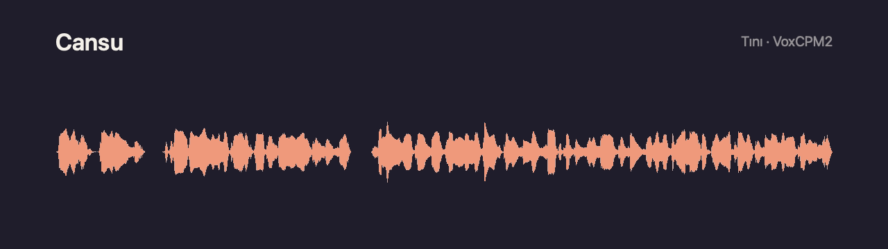
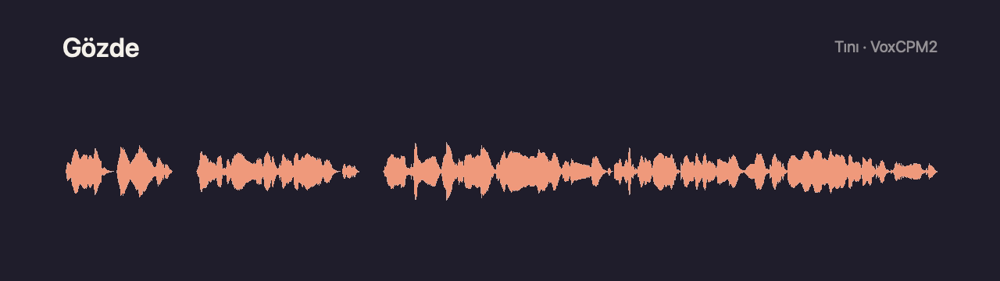

# Tını

**A desktop GUI for VoxCPM2: local Turkish voice design, cloning and narration on macOS (Apple Silicon).**

> Türkçe: [README.tr.md](README.tr.md). The app's UI is in Turkish; the code and developer docs are in English.

**Download:** `Tini_<version>_aarch64.dmg` from [Releases](https://github.com/mustafamasa/tini/releases/latest)
(Apple Silicon, macOS 14+). On first launch, see [Known limitations](#known-limitations) for the Gatekeeper step.

## What Tını is

Tını is a graphical front end for [VoxCPM2](https://huggingface.co/openbmb/VoxCPM2), the open speech model by
[OpenBMB](https://github.com/OpenBMB) (Apache-2.0). It runs the official [VoxCPM](https://github.com/OpenBMB/VoxCPM)
library on your Mac's GPU and wraps it in a studio: a script editor, a voice library, a job queue, subtitles and
export.

**The voice capabilities belong to VoxCPM2.** Tını does not train, fine-tune or modify the model, and it does not
ship its weights. You download them from Hugging Face on first run. Voice design from a text description, voice
cloning from a short recording, multilingual speech and the sound quality are all VoxCPM2's work. Transcription
comes from [whisper.cpp](https://github.com/ggml-org/whisper.cpp) running OpenAI's Whisper model.

What Tını adds around the models:

- Turkish text preparation: numbers with suffixes, abbreviations, citations, sentence splitting, and a pronunciation dictionary.
- A single-GPU job queue with history, cancel, retry and time estimates.
- A voice library with built-in, designed and cloned voices.
- Word timing, subtitle export and timed narration from SRT/VTT.
- A quality review that re-transcribes each reading.
- A local HTTP API (OpenAPI 3.1).

Everything runs on the Mac; after the one-time downloads no network connection is needed.

Tını is an independent project and is not affiliated with OpenBMB, ModelBest or OpenAI.

## Built-in voices and samples

Tını ships with two Turkish voices, **Cansu** and **Gözde**. Both were created with Tını's voice design: VoxCPM2
generated them from a written description. They are not recordings or clones of real people. The samples below were
read by VoxCPM2 through Tını with these voices, without editing (only encoded to MP3 and MP4).

**Cansu** · [MP3](docs/samples/cansu.mp3) · [Video](docs/samples/cansu.mp4)

[](docs/samples/cansu.mp4)

> Merhaba, ben Cansu. Tını'da yazılı bir tariften tasarlanmış bir sesim. Sabahın erken saatlerinde vapur iskelesinde simit kokusu, martı sesleri ve çay bardaklarının tıngırtısı birbirine karışır.

**Gözde** · [MP3](docs/samples/gozde.mp3) · [Video](docs/samples/gozde.mp4)

[](docs/samples/gozde.mp4)

> Merhaba, ben Gözde. Beni de Tını'nın ses tasarımı yarattı. Bin dokuz yüz doksan dört yılının bir yaz akşamında, küçük bir sahil kasabasında herkes aynı radyonun başında toplanmıştı.

## Features

| Area | What it does |
|---|---|
| **Studio** | Script editor: one sentence per line, line-level issue hints, pause marks, pronunciation-dictionary highlighting and drafts. Also a voice picker, the 30 languages VoxCPM2 supports with auto-detection, and duration and job-time estimates. The result view has a waveform player, live line and word highlighting, and per-line regeneration with a new seed or edited text. |
| **Voice design** | A new voice from an English description plus a design text, with N variants from random or fixed seeds and optional preview text. A gallery holds 144 sample prompts (18 roles × 8 languages). Each run is a design study kept outside the library; add the variants you like with one click. |
| **Library** | Two built-in voices (Cansu, Gözde) plus your designed voices and consented clones. Search, filters, favorites, rename, trash and restore, import and export of voice folders. A noisy reference is flagged. |
| **Clone** | Your own voice or one you have explicit permission for; the consent checkbox is mandatory and asked once. Load a file, drag and drop it, or record with the in-app microphone. Whisper can fill in the transcript. Recordings are processed in a temp folder and deleted afterwards. |
| **Timed narration** | Reads SRT/VTT cues and places each one at its timestamp. A line that does not fit is time-stretched (WSOLA) or shifted. VTT `<v>` tags can get their own voices, and the result can be muxed into a video with ffmpeg. |
| **Transcribe** | Audio or video to text with whisper.cpp (large-v3-turbo, Metal), with sentence and word timestamps and SRT/VTT/TXT export. |
| **Quality review** | Re-transcribes a reading and computes the per-line word error rate against the target text. |
| **Fix text** | Makes text speakable: Turkish numbers with suffixes (1994'te → bin dokuz yüz doksan dörtte), abbreviations, citations, parentheses, quotes and sentence splitting. |
| **Jobs** | Persistent history and the job queue (SQLite): re-run, cancel, star and notes. Export to WAV, MP3, SRT, VTT and word-timing JSON, with an "AI-generated" tag. |
| **API** | A local HTTP API with the same job types as the app, off by default ([API](#local-http-api)). |

## Architecture

```
┌────────────────────────────┐   Tauri commands    ┌──────────────────────────────┐  JSON lines   ┌──────────────────────────────┐
│ app/  React 19 + TypeScript │ ──────────────────► │ crates/tini-core  (Rust)      │ ────────────► │ engine/voxcpm/tini_engine.py │
│ pages, components, zustand  │ ◄────────────────── │ queue, jobs, SQLite, voices,  │ ◄──────────── │ persistent Python sidecar    │
└────────────────────────────┘   events (progress)  │ text, word timing, subtitles, │  stdin/stdout │ official VoxCPM → VoxCPM2    │
        app/src-tauri (Tauri 2 shell)                │ export, local HTTP API        │               │ PyTorch MPS, bfloat16        │
                                                     └──────────────┬───────────────┘               └──────────────────────────────┘
                                                                    │ subprocess
                                                                    ▼
                                                     whisper-cli (whisper.cpp, Metal): transcription, word alignment, review
```

There are three processes and one source of truth:

1. **The UI** (`app/`) is a React app inside a Tauri 2 window. It never touches files or models directly; it calls
   Tauri commands and listens to progress events.
2. **The core** (`crates/tini-core`) is a Rust library that owns all state: the SQLite store, the job queue, the voice
   library, text processing, audio post-processing and export. The Tauri shell, the CLI (`tini-cli`) and the HTTP API
   are three thin front ends on the same `Studio` type, so a job behaves the same whichever way it was started.
3. **The engine** (`engine/voxcpm/tini_engine.py`) is a long-lived Python process that hosts VoxCPM2. The core starts
   it on the first job and stops it after an idle period.

### The model: VoxCPM2

VoxCPM2 is a tokenizer-free text-to-speech model with about 2 billion parameters. It generates speech in a
continuous latent space instead of discrete audio tokens. It supports 30 languages, Turkish among them, and outputs
48 kHz audio. OpenBMB reports training on about 2.36 million hours of multilingual speech.

```
text      ─► TSLM   text-semantic language model (MiniCPM-4 base)
reference ─► LocEnc local encoder ─► RALM residual acoustic language model
                │
                ▼
            LocDiT  local diffusion transformer (flow matching): inference_timesteps, cfg_value
                │
                ▼
            AudioVAE V2  (16 kHz encode → 48 kHz decode) ─► waveform
```

Speech is generated autoregressively in patches, and a local diffusion transformer fills in the detail of each patch.
Tını uses three of the generation modes the library offers:

| Mode | Input | Used by |
|---|---|---|
| Voice design | `"(description)text"`, no reference | **Ses tasarımı**: a new voice from a description |
| Hi-fi ("ultimate") cloning | reference audio as prompt and reference, plus its exact transcript | **Stüdyo** readings and **Ses klonla**: closest timbre, rhythm and room |
| Reference-only cloning | reference audio only | Readings from a voice whose reference has no transcript |

The library's own text normalization (`normalize`) and reference denoiser (`denoise`, ZipEnhancer) are off. Tını
has its own Turkish text fixer, and the denoiser would resample the reference to 16 kHz and pull in extra dependencies.
The solver steps (`inference_timesteps`, default 10) and guidance (`cfg_value`, default 2.0) are adjustable in
**Ayarlar → Motor**.

### The engine sidecar

- **Runtime.** PyTorch on the Apple GPU (MPS) in bfloat16: about 5.5 GB of memory, about 20 s to load and 3–7 s per
  sentence on an M4 with 16 GB. float32 is available in the settings but swaps on 16 GB Macs.
- **Protocol.** One JSON object per line.
  - Commands on stdin: `load`, `generate` (a batch of requests), `cancel`, `status`, `shutdown`.
  - Events on stdout: `ready`, `request_done`, `request_failed`, `batch_done`, `cancelled`, `error`, `status`.
  - stdout is reserved for the protocol. Everything libraries print goes to stderr; the core keeps its last lines
    and attaches them to error messages.
- **Prompt cache.** Encoding a voice's reference (AudioVAE) happens once per voice. The result is kept in memory (8
  entries) and on disk under `cache/`, keyed by the reference audio, its transcript and the engine version.
- **Bad-case retries.** If the audio comes out far longer than the text implies (a VoxCPM failure mode), the sidecar
  retries up to three times and reports the attempt count.
- **Seeds.** Every request carries a seed (`torch.manual_seed`), so the same voice, text and seed give the same reading.
- **Lifecycle.** The core spawns the sidecar with the app's private Python on the first job and stops it after
  `idle_unload_min` minutes idle (default 10); if the process dies, the next job starts a new one. A cancel stops
  before the next request.

### The Rust core

| Module | Responsibility |
|---|---|
| `studio.rs` | The single entry point used by the Tauri shell, the CLI and the HTTP API |
| `queue.rs`, `store.rs` | Persistent job queue (one GPU job at a time) and the SQLite store: jobs, drafts, voice overrides, key-value |
| `jobs.rs` | Job types: read, design, clone, line regeneration, transcribe, review, timed narration |
| `engine.rs`, `engine_env.rs` | Sidecar process management and the private Python environment (installed with the bundled `uv`) |
| `model.rs` | VoxCPM2 download from a pinned commit, per-file sha256, resumable |
| `voices.rs`, `voice_prompts.rs` | Voice library (built-in, designed, cloned) and the 144 sample prompts |
| `text.rs`, `text_fix.rs` | Quote stripping, pronunciation dictionary, lines and pauses, language detection, the Turkish text fixer |
| `word_timing.rs`, `transcribe.rs` | Word timing (Whisper alignment snapped to the audio energy) and whisper.cpp transcription |
| `subtitles.rs` | SRT/VTT parsing, cue placement, WSOLA time-stretch, ffmpeg muxing |
| `audio.rs`, `tone.rs`, `export.rs` | Decoding (wav, flac, mp3, ogg, m4a…), peak limiting, noise-floor measurement, optional tone match, WAV/MP3/SRT/VTT/JSON export |
| `estimate.rs` | Duration estimates learned from finished jobs, per device, precision and step count |
| `api.rs` | Local HTTP API (OpenAPI 3.1 spec in `api_spec.json`) |

Audio post-processing stays outside the model: design output above 0.97 peak is scaled to 0.94 so 16-bit export
does not clip, and every reference gets a noise-floor measurement so a hissing voice is flagged before you use it.

### Word timing and transcription

whisper.cpp (v1.9.5, Metal) ships as a bundled binary; the Whisper large-v3-turbo model (~550 MB) is downloaded on
demand from the Transcribe page. It is used in three places:

- **Transcribe**: audio or video to text, with segments and word timestamps.
- **Word timing**: each reading is transcribed once, the heard words are aligned to the target words, then the
  boundaries are snapped to the audio energy. This drives word highlighting, word-level subtitles and trimming.
  Without the Whisper model, timings fall back to a letter-proportional estimate.
- **Quality review**: per-line word error rate of a reading against its text.

### UI and shell

| Layer | Stack |
|---|---|
| Shell | Tauri 2 (Rust), asset protocol for local audio, ad-hoc signed `.app` |
| UI | React 19, TypeScript, Vite, Tailwind CSS v4, zustand |
| Editor and audio | CodeMirror 6 (script editor with lint marks), wavesurfer.js (waveforms) |
| Icons | lucide |

The UI language is Turkish; design rules for contributors are in [CONTRIBUTING.md](CONTRIBUTING.md).

### Setup and downloads

The app bundles [`uv`](https://github.com/astral-sh/uv) and the whisper.cpp binary. The setup screen then runs two
one-time steps:

1. **Voice engine.** A private Python 3.12 environment is installed under the data folder from the pinned
   [`engine/voxcpm/requirements.txt`](engine/voxcpm/requirements.txt) (PyTorch, transformers and friends, about 1 GB).
   VoxCPM itself is installed with `--no-deps`, so demo and training packages (gradio, funasr, modelscope, datasets)
   are left out. The environment does not touch the system Python.
2. **Model.** The seven VoxCPM2 files (4.6 GB) are downloaded from a pinned Hugging Face commit. Each file is checked
   with sha256, and the download resumes where it stopped. An existing model folder can be used instead.

### Data

Everything lives in `~/Library/Application Support/Tini/`:

| Path | Contents |
|---|---|
| `voices/` | Library voices: `voice.json` plus the reference recording |
| `designs/` | Design studies and their variants (not in the library until added) |
| `jobs/` | Results of each job: line WAVs, the mixed reading, word timings |
| `cache/` | Prompt cache (reference encodings) |
| `work/` | Temporary work files, such as a clone recording while it is processed |
| `engine_env/`, `python/` | The private Python environment and the Python 3.12 interpreter uv installs for it |
| `model/VoxCPM2/` | Model weights |
| `whisper/` | Whisper model |
| `tini.sqlite`, `settings.json` | Job queue and history, drafts, voice overrides; user settings |
| `pronunciation_dictionary.tsv` | Your copy of the pronunciation dictionary (copied from the bundle on first run; edit it in Ayarlar → Okunuş sözlüğü) |

Built-in voices are read-only and ship inside the app bundle (`resources/voices/`).

### Why the official library

On the same input, a GGUF/C++ port produced a +18 dB bump at 7–9 kHz (audible hiss); the official PyTorch pipeline
does not. The same comparison ruled out float32 on MPS (swaps on 16 GB Macs) and kept bfloat16, which measured the
same as float32 in every band.

## Performance

M4, 16 GB, bfloat16, 10 solver steps:

| Job | Time |
|---|---|
| Model load (first job, or after the idle unload) | 15–20 s |
| Per sentence, model loaded | 3–7 s |
| Reading, 4 lines / 17 s of audio (load and word timing included) | 67 s |
| Clone, 3 lines / 12 s of audio (load included) | 44 s |
| Voice design, 2 variants and 2 preview readings | 69 s |

## Local HTTP API

Tını can expose a local HTTP API (OpenAPI 3.1) so scripts and other apps on the same Mac can queue readings, designs
and clones and fetch the results. It is off by default.

- **Enable it** in the app under **Ayarlar → Yerel API**: turn it on, optionally change the port (default `7860`), and copy
  the token. The server binds to `127.0.0.1` only; it is never reachable from the network. If the port is busy the
  app keeps working and the settings screen shows the error.
- **Auth.** Every `/v1/*` route except `/v1/health` needs `Authorization: Bearer <token>`. "Yenile" (regenerate) in
  the settings replaces the token; the old one stops working immediately. Errors are JSON:
  `{"error": {"code": "...", "message": "..."}}` (401 without a valid token, 404 for unknown jobs, 422 with
  `error.issues` when a request fails validation).
- **Reference.** `http://127.0.0.1:7860/docs` lists every endpoint with a curl example;
  `http://127.0.0.1:7860/openapi.json` is the machine-readable spec (no token needed for either).

| Method | Path | Description |
|---|---|---|
| GET | `/v1/health` | `{"status": "ok", "version"}` (no token) |
| GET | `/v1/status` | Engine, model and system status |
| GET | `/v1/voices` | Library voices (`id` is what `voice` expects) |
| POST | `/v1/jobs` | Queue a job (same JSON as the app: `kind` = `read`, `design`, `clone`, `timed`, ...) → `201` job |
| GET | `/v1/jobs?kind=&status=&limit=` | Job history, newest first |
| GET | `/v1/jobs/{id}` | One job with progress and, when done, its `result` |
| POST | `/v1/jobs/{id}/cancel` | Cancel a queued or running job → `204` |
| GET | `/v1/jobs/{id}/audio` | The finished reading/clone/timed WAV (`409` while not done) |
| POST | `/v1/text/check` | `{text, language?, voice?}` → issues, duration estimate |
| POST | `/v1/text/fix` | `{text, language?, options?}` → speakable text and the list of changes |

```bash
TOKEN=...   # Ayarlar → Yerel API
curl http://127.0.0.1:7860/v1/health
curl -H "Authorization: Bearer $TOKEN" http://127.0.0.1:7860/v1/voices

# queue a reading, poll it, download the WAV
JOB=$(curl -s -H "Authorization: Bearer $TOKEN" -H "Content-Type: application/json" \
  -d '{"kind": "read", "voice": "builtin/cansu", "text": "Merhaba, bu bir deneme okumasıdır."}' \
  http://127.0.0.1:7860/v1/jobs | python3 -c 'import json, sys; print(json.load(sys.stdin)["id"])')
curl -H "Authorization: Bearer $TOKEN" http://127.0.0.1:7860/v1/jobs/$JOB
curl -H "Authorization: Bearer $TOKEN" -o reading.wav http://127.0.0.1:7860/v1/jobs/$JOB/audio
```

Jobs queued through the API run on the same single-GPU queue as the app and show up in Üretimler. Clone requests
must send `"consent": true` (your own voice or the owner's explicit permission), and `recording` is a path on this Mac.
For development without the app, `tini-cli serve` runs the same API in the foreground.

## Repository layout

| Path | Contents |
|---|---|
| `crates/tini-core/` | Rust core library and `tini-cli` (headless CLI for every job type) |
| `app/` | React/TypeScript UI (`src/pages`, `src/components`, `src/store.ts`, `src/api.ts`) |
| `app/src-tauri/` | Tauri shell: commands, event bridge, bundle config |
| `engine/voxcpm/` | Python sidecar and pinned requirements |
| `engine/scripts/` | Build script for the bundled whisper.cpp binary |
| `resources/` | Built-in voices (`voices/`, see its README for consent terms), sample voice prompts, Turkish pronunciation dictionary, flags |
| `docs/` | Brand assets (`docs/brand/`) and the voice samples shown above (`docs/samples/`) |

## Development

Requirements:
- macOS 14+ on Apple Silicon.
- Rust (stable), Node 22+ with pnpm, Xcode command line tools, `cmake`.
- Two binaries in `app/src-tauri/binaries/` (not committed):
  - `uv-aarch64-apple-darwin`: copy of a [uv](https://github.com/astral-sh/uv/releases) release binary.
  - `whisper_cli-aarch64-apple-darwin`: build it with `bash engine/scripts/build_whisper_macos.sh`.

```bash
cd app
pnpm install
pnpm tauri dev      # run the app
pnpm tauri build    # .app and .dmg in target/release/bundle/
```

Core library and CLI:

```bash
cargo test --workspace
cargo run -p tini-core --bin tini-cli -- status
cargo run -p tini-core --bin tini-cli -- install-env             # Python env via uv
cargo run -p tini-core --bin tini-cli -- read builtin/cansu "Merhaba dünya."
cargo run -p tini-core --bin tini-cli -- serve                   # local HTTP API in the foreground
```

The CLI also has `voices`, `jobs`, `design`, `clone --consent`, `line`, `job <JSON>`, `use-model <dir>`, `raw` and
`tone`. The full list is at the top of
[`crates/tini-core/src/bin/tini-cli.rs`](crates/tini-core/src/bin/tini-cli.rs). Environment variables:
`TINI_DATA_DIR` (use a separate data folder), `TINI_RESOURCES`, `TINI_UV`, `TINI_WHISPER`, and `TINI_NO_WORKER=1`
(only enqueue, so the running app executes the job).

UI preview in a browser (no Tauri, mocked commands with data captured from a real data dir; no audio):

```bash
cargo run -p tini-core --bin tini-cli -- json app/preview-data/data.json
pnpm --dir app dev   # http://localhost:1420
```

See [CONTRIBUTING.md](CONTRIBUTING.md) for conventions and checks.

## Known limitations

- macOS on Apple Silicon only. 16 GB of RAM is recommended; the model uses about 5.5 GB in bfloat16.
- The build is ad-hoc signed (no notarization), so macOS blocks the first launch of a downloaded copy. Try to open it
  once, then choose **System Settings → Privacy & Security → Open Anyway**, or run
  `xattr -dr com.apple.quarantine /Applications/Tını.app`.
- Muxing into video requires `ffmpeg` on the system.
- VoxCPM2 features not exposed yet: style-controlled cloning (`"(style)text"` with a reference), streaming
  generation and LoRA fine-tuning.

## Responsible use and license

Code: Apache-2.0 ([LICENSE](LICENSE)). VoxCPM and the VoxCPM2 weights are Apache-2.0 by OpenBMB; whisper.cpp and the
Whisper model are MIT. All third-party components: [THIRD_PARTY_LICENSES.md](THIRD_PARTY_LICENSES.md).

Generated speech is synthetic; label it as AI-generated when you publish it. The built-in voices Cansu and Gözde are
synthetic voices made with Tını's voice design and are not based on real people
([resources/voices/README.md](resources/voices/README.md)). Clone a voice only if it is your own or you
have the speaker's explicit permission. Impersonation, fraud and deception are prohibited.

## Credits

- [VoxCPM / VoxCPM2](https://github.com/OpenBMB/VoxCPM) by OpenBMB: the speech model and inference library behind
  every voice Tını produces.
- [whisper.cpp](https://github.com/ggml-org/whisper.cpp) by ggml-org and [Whisper](https://github.com/openai/whisper)
  by OpenAI: transcription and word timing.
- [voxcpm2-turkce-ses-tasarimi](https://github.com/alexturkey/voxcpm2-turkce-ses-tasarimi) by Ali Haydar Öztürk: the
  sample voice prompts and the Turkish pronunciation dictionary.
