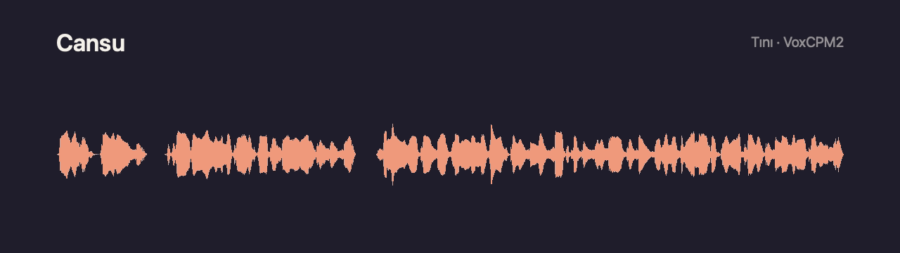
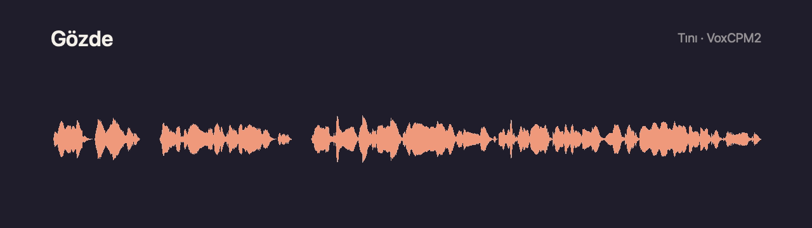

# Tını

**VoxCPM2 için masaüstü arayüzü: macOS'te (Apple Silicon) yerel Türkçe ses tasarımı, klonlama ve seslendirme.**

> English: [README.md](README.md). Geliştirici belgeleri İngilizcedir; ayrıntılı geliştirme notları için
> [CONTRIBUTING.md](CONTRIBUTING.md).

## Tını nedir

Tını, [OpenBMB](https://github.com/OpenBMB)'nin açık kaynak konuşma modeli
[VoxCPM2](https://huggingface.co/openbmb/VoxCPM2) (Apache-2.0) için yapılmış bir grafik arayüzdür (GUI). Resmi
[VoxCPM](https://github.com/OpenBMB/VoxCPM) kütüphanesini Mac'inizin GPU'sunda çalıştırır ve çevresine bir stüdyo
kurar: metin düzenleyici, ses kitaplığı, iş kuyruğu, altyazı ve dışa aktarım.

**Seslendirme yetenekleri VoxCPM2'ye aittir.** Tını modeli eğitmez, ince ayar yapmaz, değiştirmez ve ağırlıklarını
dağıtmaz; model ilk açılışta Hugging Face'ten indirilir. Tarifle ses tasarlama, kısa bir kayıttan ses klonlama, çok
dilli konuşma ve ses kalitesi VoxCPM2'nin işidir. Transkript ise OpenAI'nin Whisper modelini çalıştıran
[whisper.cpp](https://github.com/ggml-org/whisper.cpp) ile yapılır.

Tını'nın modellerin çevresine kattıkları:

- Türkçe metin hazırlama: ekleriyle sayılar, kısaltmalar, kaynak gösterimleri, cümlelere bölme ve okunuş sözlüğü.
- Tek GPU'lu iş kuyruğu: geçmiş, iptal, yeniden üretme ve süre tahmini.
- Hazır, tasarlanmış ve klonlanmış seslerden oluşan bir kitaplık.
- Kelime zamanları, altyazı dışa aktarımı ve SRT/VTT'den zamanlı seslendirme.
- Her okumayı yeniden dinleyip kontrol eden kalite denetimi.
- Yerel HTTP API (OpenAPI 3.1).

Her şey Mac'te çalışır; tek seferlik indirmelerden sonra internet bağlantısı gerekmez.

Tını bağımsız bir projedir; OpenBMB, ModelBest ya da OpenAI ile bağlantısı yoktur.

## Hazır sesler ve örnekler

Uygulama iki Türkçe sesle gelir: **Cansu** ve **Gözde**. İkisi de Tını'nın ses tasarımıyla oluşturuldu: VoxCPM2 onları
yazılı bir tariften üretti. Gerçek bir kişinin kaydı ya da klonu değildirler. Aşağıdaki örnekleri bu seslerle Tını
üzerinden VoxCPM2 okudu; kayıtlar düzenlenmedi (yalnız MP3 ve MP4'e dönüştürüldü). Ayrıntı:
[resources/voices/README.md](resources/voices/README.md).

**Cansu** · [MP3](docs/samples/cansu.mp3) · [Video](docs/samples/cansu.mp4)

[](docs/samples/cansu.mp4)

> Merhaba, ben Cansu. Tını'da yazılı bir tariften tasarlanmış bir sesim. Sabahın erken saatlerinde vapur iskelesinde simit kokusu, martı sesleri ve çay bardaklarının tıngırtısı birbirine karışır.

**Gözde** · [MP3](docs/samples/gozde.mp3) · [Video](docs/samples/gozde.mp4)

[](docs/samples/gozde.mp4)

> Merhaba, ben Gözde. Beni de Tını'nın ses tasarımı yarattı. Bin dokuz yüz doksan dört yılının bir yaz akşamında, küçük bir sahil kasabasında herkes aynı radyonun başında toplanmıştı.

## Kurulum

1. [Releases](https://github.com/mustafamasa/tini/releases/latest) sayfasından `Tini_<sürüm>_aarch64.dmg` dosyasını
   indirin, Tını'yı Uygulamalar klasörüne sürükleyin.
2. Paket Apple tarafından onaylanmadığı (notarization yok) için macOS ilk açılışı engeller. Bir kez açmayı deneyin,
   sonra **Sistem Ayarları → Gizlilik ve Güvenlik** bölümünde Tını için **Yine de Aç**'a basın. Terminal kullanıyorsanız
   aynı işi şu komut yapar: `xattr -dr com.apple.quarantine /Applications/Tını.app`
3. Kurulum ekranında önce **Ses motorunu kur** (~1 GB, uygulamaya özel Python), sonra **Modeli indir** (4,6 GB).
4. Transkript ve kelime zamanları için Transkript sayfasından konuşma tanıma modelini indirin (~550 MB, isteğe bağlı).

16 GB bellek önerilir; model bfloat16'da yaklaşık 5,5 GB kullanır.

## Özellikler

| Bölüm | Ne yapar |
|---|---|
| **Stüdyo** | Metin düzenleyici: satır başına bir cümle, satır bazında sorun ipuçları, durak işaretleri, okunuş sözlüğü vurgusu ve taslaklar. Ses seçici, VoxCPM2'nin desteklediği 30 dil ve otomatik dil tanıma, süre ve iş süresi tahmini. Sonuç ekranında dalga formlu oynatıcı, canlı satır ve kelime vurgusu, satırı yeni tohumla ya da düzeltilmiş metinle yeniden seslendirme. |
| **Ses tasarımı** | İngilizce bir tarif ve tasarım metninden yeni ses; rastgele ya da sabit tohumlarla birkaç çeşit, isteğe bağlı dinleme metni. 144 örnek tarif (18 rol × 8 dil). Her tasarım kitaplık dışında ayrı bir çalışma olarak durur; beğendiğiniz çeşidi tek tıkla kitaplığa eklersiniz. |
| **Kitaplık** | İki hazır ses (Cansu, Gözde), tasarladığınız sesler ve izinli klonlar. Arama, süzgeçler, favoriler, yeniden adlandırma, çöp kutusu, ses klasörü içe ve dışa aktarma. Gürültülü referanslar işaretlenir. |
| **Ses klonla** | Yalnız kendi sesiniz ya da açık izin aldığınız bir ses; izin onayı zorunludur ve bir kez sorulur. Dosya, sürükle-bırak ya da uygulama içi mikrofon. Kaydın metni Whisper ile doldurulabilir. Kayıt geçici klasörde işlenir ve sonra silinir. |
| **Altyazıdan seslendirme** | SRT/VTT satırlarını kendi zamanlarına oturtarak okur. Sığmayan satır perdesi değişmeden hızlandırılır (WSOLA) ya da kaydırılır. VTT `<v>` etiketlerindeki konuşmacılara ayrı ses verilebilir; sonuç ffmpeg ile videoya bindirilebilir. |
| **Transkript** | Ses ya da videoyu whisper.cpp ile (large-v3-turbo, Metal) yazıya döker; cümle ve kelime zamanları, SRT/VTT/TXT dışa aktarımı. |
| **Kalite kontrolü** | Okumayı yeniden yazıya döker ve hedef metne göre satır satır kelime hata oranını hesaplar. |
| **Metni düzelt** | Metni okunabilir hale getirir: ekleriyle Türkçe sayılar (1994'te → bin dokuz yüz doksan dörtte), kısaltmalar, kaynak gösterimleri, parantezler, tırnaklar ve cümlelere bölme. |
| **Üretimler** | Kalıcı geçmiş ve iş kuyruğu (SQLite): yeniden üretme, iptal, yıldız ve not. WAV, MP3, SRT, VTT ve kelime zamanı JSON'u olarak "yapay zekâ ile üretildi" etiketiyle dışa aktarım. |
| **API** | Uygulamadaki iş türlerinin aynısını sunan yerel HTTP API; varsayılan olarak kapalı. Ayrıntı: [README.md](README.md#local-http-api). |

## Teknik altyapı

```
┌────────────────────────────┐  Tauri komutları   ┌──────────────────────────────┐  JSON satırları ┌──────────────────────────────┐
│ app/  React 19 + TypeScript │ ─────────────────► │ crates/tini-core  (Rust)      │ ──────────────► │ engine/voxcpm/tini_engine.py │
│ sayfalar, bileşenler,       │ ◄───────────────── │ kuyruk, işler, SQLite, sesler,│ ◄────────────── │ kalıcı Python yan süreci     │
│ zustand                     │  olaylar (ilerleme)│ metin, kelime zamanı, altyazı,│  stdin/stdout   │ resmi VoxCPM → VoxCPM2       │
└────────────────────────────┘                     │ dışa aktarım, yerel HTTP API  │                 │ PyTorch MPS, bfloat16        │
        app/src-tauri (Tauri 2 kabuğu)              └──────────────┬───────────────┘                 └──────────────────────────────┘
                                                                   │ alt süreç
                                                                   ▼
                                                    whisper-cli (whisper.cpp, Metal): transkript, kelime hizalama, kalite kontrolü
```

Üç süreç ve tek bir doğruluk kaynağı vardır:

1. **Arayüz** (`app/`), Tauri 2 penceresinde çalışan bir React uygulamasıdır. Dosyalara ya da modellere doğrudan
   dokunmaz; Tauri komutlarını çağırır ve ilerleme olaylarını dinler.
2. **Çekirdek** (`crates/tini-core`), bütün durumu yöneten Rust kütüphanesidir: SQLite deposu, iş kuyruğu, ses
   kitaplığı, metin işleme, ses son işleme ve dışa aktarım. Tauri kabuğu, komut satırı (`tini-cli`) ve HTTP API aynı
   `Studio` tipinin üstünde ince katmanlardır; bir iş nereden başlatılırsa başlatılsın aynı davranır.
3. **Motor** (`engine/voxcpm/tini_engine.py`), VoxCPM2'yi barındıran uzun ömürlü bir Python sürecidir. Çekirdek onu
   ilk işte başlatır, belli bir süre boşta kalınca kapatır.

### Model: VoxCPM2

VoxCPM2, yaklaşık 2 milyar parametreli, tokenizer'sız bir metinden konuşmaya modelidir; sesi ayrık ses token'ları
yerine sürekli bir gizli uzayda üretir. Türkçe dahil 30 dili destekler ve 48 kHz çıktı verir. OpenBMB, modelin
yaklaşık 2,36 milyon saatlik çok dilli konuşmayla eğitildiğini belirtiyor.

```
metin    ─► TSLM   metin-anlam dil modeli (MiniCPM-4 tabanı)
referans ─► LocEnc yerel kodlayıcı ─► RALM artık akustik dil modeli
                │
                ▼
            LocDiT yerel difüzyon dönüştürücüsü (akış eşleme): inference_timesteps, cfg_value
                │
                ▼
            AudioVAE V2 (16 kHz kodlama → 48 kHz çözme) ─► dalga biçimi
```

Ses yamalar halinde ve özbağlanımlı olarak üretilir; her yamanın ayrıntısını yerel difüzyon dönüştürücüsü doldurur.
Tını, kütüphanenin sunduğu üretim kiplerinden üçünü kullanır:

| Kip | Girdi | Tını'da |
|---|---|---|
| Ses tasarımı | `"(tarif)metin"`, referans yok | **Ses tasarımı**: tariften yeni ses |
| En sadık klonlama ("ultimate") | referans kayıt hem istem hem referans olarak, birebir metniyle | **Stüdyo** okumaları ve **Ses klonla**: tını, ritim ve oda en sadık biçimde |
| Yalnız referansla klonlama | yalnız referans kayıt | Referansının metni olmayan bir sesle okuma |

Kütüphanenin kendi metin normalleştirmesi (`normalize`) ve referans gürültü gidericisi (`denoise`, ZipEnhancer)
kapalıdır. Tını'nın kendi Türkçe metin düzelticisi var; gürültü giderici ise referansı 16 kHz'e indirir ve ek
bağımlılık getirir. Çözücü adımı (`inference_timesteps`, varsayılan 10) ve yönlendirme (`cfg_value`, varsayılan 2.0)
**Ayarlar → Motor** bölümünden değiştirilebilir.

### Motor yan süreci

- **Çalışma ortamı.** Apple GPU'da (MPS) bfloat16 ile PyTorch: yaklaşık 5,5 GB bellek, ~20 sn yükleme, M4 16 GB'ta
  cümle başına 3-7 sn. Ayarlardan float32 seçilebilir ama 16 GB Mac'te takasa düşer.
- **Protokol.** Satır başına bir JSON nesnesi.
  - stdin'den komutlar: `load`, `generate` (bir istek kümesi), `cancel`, `status`, `shutdown`.
  - stdout'a olaylar: `ready`, `request_done`, `request_failed`, `batch_done`, `cancelled`, `error`, `status`.
  - stdout yalnız protokole ayrılmıştır. Kütüphanelerin yazdığı her şey stderr'e gider; çekirdek son satırlarını
    tutar ve hata mesajlarına ekler.
- **İstem önbelleği.** Bir sesin referansının kodlanması (AudioVAE) ses başına bir kez yapılır. Sonuç bellekte (8
  kayıt) ve diskte `cache/` altında tutulur; anahtar referans kaydı, metni ve motor sürümüdür.
- **Kötü örnek denemesi.** Ses metne göre çok uzun çıkarsa (VoxCPM'in bilinen bir hata biçimi) yan süreç en çok üç
  kez yeniden dener ve deneme sayısını bildirir.
- **Tohum.** Her istek bir tohum taşır (`torch.manual_seed`); aynı ses, metin ve tohum aynı okumayı verir.
- **Yaşam döngüsü.** Çekirdek yan süreci uygulamaya özel Python ile ilk işte başlatır, `idle_unload_min` dakika
  (varsayılan 10) boşta kalınca kapatır; süreç çökerse bir sonraki iş yenisini başlatır. İptal, sıradaki istekten
  önce durdurur.

### Rust çekirdeği

| Modül | Görevi |
|---|---|
| `studio.rs` | Tauri kabuğunun, komut satırının ve HTTP API'nin kullandığı tek giriş noktası |
| `queue.rs`, `store.rs` | Kalıcı iş kuyruğu (GPU'da aynı anda tek iş) ve SQLite deposu: işler, taslaklar, ses ayarları, anahtar-değer |
| `jobs.rs` | İş türleri: okuma, tasarım, klon, satır yenileme, transkript, kalite kontrolü, altyazıdan seslendirme |
| `engine.rs`, `engine_env.rs` | Yan süreç yönetimi ve uygulamaya özel Python ortamı (uygulamayla gelen `uv` ile kurulur) |
| `model.rs` | VoxCPM2'yi sabit commit'ten indirme, dosya başına sha256, kaldığı yerden sürdürme |
| `voices.rs`, `voice_prompts.rs` | Ses kitaplığı (hazır, tasarlanmış, klon) ve 144 örnek tarif |
| `text.rs`, `text_fix.rs` | Tırnak temizleme, okunuş sözlüğü, satır ve durak ayrıştırma, dil tanıma, Türkçe metin düzeltici |
| `word_timing.rs`, `transcribe.rs` | Kelime zamanı (Whisper hizalaması, sesin enerjisine oturtulur) ve whisper.cpp ile transkript |
| `subtitles.rs` | SRT/VTT ayrıştırma, satır yerleştirme, WSOLA ile hızlandırma, ffmpeg ile videoya bindirme |
| `audio.rs`, `tone.rs`, `export.rs` | Çözme (wav, flac, mp3, ogg, m4a…), tepe sınırlama, gürültü zemini ölçümü, isteğe bağlı ton eşitleme, WAV/MP3/SRT/VTT/JSON dışa aktarım |
| `estimate.rs` | Biten işlerden öğrenilen süre tahminleri (cihaz, hassasiyet ve adıma göre ayrı) |
| `api.rs` | Yerel HTTP API (OpenAPI 3.1 belgesi `api_spec.json` içinde) |

Ses son işleme modelin dışında kalır: tepe değeri 0,97'yi aşan tasarım çıktısı 16 bit dışa aktarımda kırpılmasın diye
0,94'e ölçeklenir. Her referansın gürültü zemini ölçülür; cızırtılı bir ses kullanılmadan önce işaretlenir.

### Kelime zamanı ve transkript

whisper.cpp (v1.9.5, Metal) uygulamayla birlikte gelir; Whisper large-v3-turbo modeli (~550 MB) Transkript
sayfasından isteğe bağlı indirilir. Üç yerde kullanılır:

- **Transkript**: ses ya da videoyu cümle ve kelime zamanlarıyla yazıya döker.
- **Kelime zamanı**: her okuma bir kez yazıya dökülür, duyulan kelimeler hedef kelimelerle hizalanır, sonra sınırlar
  sesin enerjisine oturtulur. Kelime vurgusu, kelime altyazısı ve satır kırpma buna dayanır. Whisper modeli yoksa
  zamanlar harf oranına göre tahmin edilir.
- **Kalite kontrolü**: okumanın metnine göre satır satır kelime hata oranı.

### Arayüz ve kabuk

| Katman | Teknoloji |
|---|---|
| Kabuk | Tauri 2 (Rust), yerel ses için asset protokolü, ad-hoc imzalı `.app` |
| Arayüz | React 19, TypeScript, Vite, Tailwind CSS v4, zustand |
| Düzenleyici ve ses | CodeMirror 6 (sorun işaretli metin düzenleyici), wavesurfer.js (dalga formları) |
| İkonlar | lucide |

### Kurulum adımları ve indirmeler

Uygulama [`uv`](https://github.com/astral-sh/uv) ve whisper.cpp ikilisiyle gelir. Kurulum ekranı iki tek seferlik
adım çalıştırır:

1. **Ses motoru.** Veri klasörünün altına, sabit sürümlü
   [`engine/voxcpm/requirements.txt`](engine/voxcpm/requirements.txt) dosyasından uygulamaya özel bir Python 3.12
   ortamı kurulur (PyTorch, transformers ve diğerleri, ~1 GB). VoxCPM'in kendisi `--no-deps` ile kurulur; gradio,
   funasr, modelscope ve datasets gibi demo ve eğitim paketleri gelmez. Ortam sistemdeki Python'a dokunmaz.
2. **Model.** VoxCPM2'nin yedi dosyası (4,6 GB) Hugging Face'teki sabit bir commit'ten iner. Her dosya sha256 ile
   doğrulanır ve indirme yarıda kalırsa kaldığı yerden sürer. Elinizdeki bir model klasörü de kullanılabilir.

### Veriler

Her şey `~/Library/Application Support/Tini/` altında durur:

| Yol | İçerik |
|---|---|
| `voices/` | Kitaplıktaki sesler: `voice.json` ve referans kaydı |
| `designs/` | Tasarım çalışmaları ve çeşitleri (eklenene kadar kitaplıkta değildir) |
| `jobs/` | Her işin sonuçları: satır WAV'ları, birleştirilmiş okuma, kelime zamanları |
| `cache/` | İstem önbelleği (referans kodlamaları) |
| `work/` | Geçici çalışma dosyaları, örneğin işlenirken klon kaydı |
| `engine_env/`, `python/` | Uygulamaya özel Python ortamı ve uv'nin onun için kurduğu Python 3.12 |
| `model/VoxCPM2/` | Model ağırlıkları |
| `whisper/` | Whisper modeli |
| `tini.sqlite`, `settings.json` | İş kuyruğu ve geçmiş, taslaklar, ses ayarları; kullanıcı ayarları |
| `pronunciation_dictionary.tsv` | Okunuş sözlüğünün size ait kopyası (ilk açılışta paketten kopyalanır; Ayarlar → Okunuş sözlüğü bölümünden düzenlenir) |

Hazır sesler salt okunurdur ve uygulama paketinin içinde gelir (`resources/voices/`).

### Neden resmi kütüphane

Aynı girdiyle bir GGUF/C++ portu 7-9 kHz bandında +18 dB şişkinlik (duyulur cızırtı) üretti; resmi PyTorch hattı
üretmiyor. Aynı karşılaştırmada MPS'te float32 elendi (16 GB Mac'te takasa düşüyor); bfloat16 seçildi, bant
ölçümleri float32 ile aynı çıktı.

## Hız

M4, 16 GB, bfloat16, 10 çözücü adımı:

| İş | Süre |
|---|---|
| Model yükleme (ilk iş ya da boşta kapandıktan sonra) | 15-20 sn |
| Model bellekteyken cümle başına | 3-7 sn |
| Okuma, 4 satır / 17 sn ses (yükleme ve kelime zamanı dahil) | 67 sn |
| Klon, 3 satır / 12 sn ses (yükleme dahil) | 44 sn |
| Ses tasarımı, 2 çeşit ve 2 dinleme okuması | 69 sn |

## Bilinen sınırlar

- Yalnız Apple Silicon'lu macOS. 16 GB bellek önerilir.
- Paket ad-hoc imzalıdır (notarization yok). İndirilen paketi ilk açarken Sistem Ayarları → Gizlilik ve Güvenlik →
  Yine de Aç gerekir (bkz. Kurulum).
- Videoya bindirme için sistemde `ffmpeg` gerekir.
- VoxCPM2'nin henüz arayüze bağlanmamış özellikleri: stil kontrollü klonlama (referansla `"(stil)metin"`), akışlı
  üretim ve LoRA ince ayarı.

## Sorumlu kullanım ve lisans

Kod: Apache-2.0 ([LICENSE](LICENSE)). VoxCPM ve VoxCPM2 ağırlıkları OpenBMB'nin Apache-2.0 lisanslı çalışmasıdır;
whisper.cpp ve Whisper modeli MIT lisanslıdır. Bütün üçüncü taraf bileşenler:
[THIRD_PARTY_LICENSES.md](THIRD_PARTY_LICENSES.md).

Üretilen sesler yapaydır; yayınlarken yapay zekâ ile üretildiğini belirtin. Klonlama yalnız kendi sesinizle ya da
sahibinin açık izniyle yapılır. İzinsiz taklit, dolandırıcılık ve yanıltma yasaktır.

## Teşekkürler

- OpenBMB'nin [VoxCPM / VoxCPM2](https://github.com/OpenBMB/VoxCPM) projesi: Tını'nın ürettiği her sesin arkasındaki
  konuşma modeli ve çıkarım kütüphanesi.
- ggml-org'un [whisper.cpp](https://github.com/ggml-org/whisper.cpp) projesi ve OpenAI'nin
  [Whisper](https://github.com/openai/whisper) modeli: transkript ve kelime zamanları.
- Ali Haydar Öztürk'ün [voxcpm2-turkce-ses-tasarimi](https://github.com/alexturkey/voxcpm2-turkce-ses-tasarimi)
  projesi: örnek ses tarifleri ve Türkçe okunuş sözlüğü.
